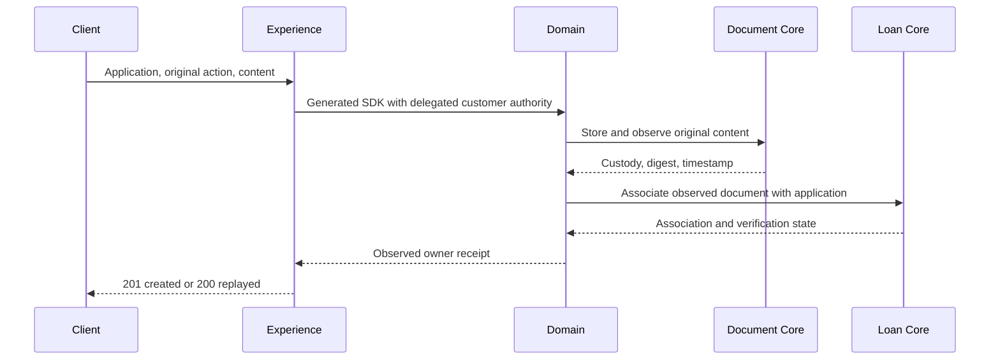

# Managed application evidence

The upload operation transfers actual content to the Loan Origination Domain. The Domain stores and reads the content through the Document Core SDK, then associates the observed document with the application through the Loan Origination Core SDK. Experience does not persist business state or call a Core SDK.

This diagram describes the implemented call path. The complete four-process deployment and restart test is still pending; source tests use controlled HTTP boundaries.

## Request and identity

Use `POST /api/v1/experience/lending/applications/{id}/documents` with a valid customer bearer token. The JSON request has these fields:

| Field | Meaning |
| --- | --- |
| `actionId` | Required nonzero UUID allocated by the caller for this operation. Retain it across recovery and exact replay. |
| `applicationId` | Optional compatibility field; when present, must match the route. |
| `fileName` | Required, at most 200 characters, without path separators, surrounding whitespace, or control characters. |
| `documentType` | Required catalog code matching `[A-Z][A-Z0-9_]{0,49}`. Domain and Core validate the business meaning. |
| `content` | Base64 encoding of the actual bytes. Decoded size is 1 through 2,097,152 bytes; the JSON envelope is limited to 3,145,728 bytes. |

The party comes from the currently verified signed HUMAN identity, never from a request field. The original issuer, subject, tenant, audience, client, scope, and party are checked across token exchange. The operation uses one five-second budget, with no renewed deadline or automatic mutation retry. Configure the native global authentication chain as well as this operation's exchange settings.

## Configure the delegation

Enable `lending.evidence.enabled=true` only with the actual Domain service and trusted token issuer configured. All settings below are required unless explicitly marked otherwise:

| Property under `lending.evidence` | Purpose |
| --- | --- |
| `issuer` | Exact trusted issuer for incoming and exchanged signed identities. |
| `incoming-audience`, `incoming-client-id` | Registered incoming customer-channel identity. |
| `platform-tenant` | Exact tenant namespace preserved across the call. |
| `domain-audience`, `domain-client-id` | Registered delegated target audience and token-exchange client. |
| `domain-endpoint` | HTTPS base URL for the real Loan Origination Domain. |
| `token-endpoint` | Trusted RFC 8693 token exchange endpoint. |
| `target-jwk-set-uri` | Trusted JWKS for validating the returned Domain token. |
| `client-secret` | Secret supplied from deployment secret storage, never checked into source. |
| `owned-loopback-sandbox` | Optional, false by default. Explicitly permits owned loopback test endpoints; it is not a production transport setting. |

The exchange requests `lending:applications:evidence:upload` using Spring's token-exchange client. Missing configuration or unavailable delegation produces an unavailable result; it never creates a document or a success receipt. Configure Domain's corresponding Core exchanges separately. A configured Experience endpoint alone does not establish deployed end-to-end integration.

## Interpret the result

A first observed complete association returns `201`; an observed original replay returns `200`. Both disable response caching. The response preserves three separate identities: `actionId` is the original operation, `storedDocumentId` is the Document owner's record, and `associationId` is the Loan owner's association. For compatibility, legacy `documentId` equals `associationId`.

`contentDigest`, `documentIntentDigest`, and `associationIntentDigest` identify different facts and must not be substituted for one another. `storedAt` and `attachedAt` are actual UTC instants. `associationState` is `ATTACHED`; `verificationStatus` remains `PENDING`. Attaching evidence does not approve its contents or approve the loan. Experience checks the receipt's identity, state, size, file metadata, and content digest before reporting success.

Malformed requests are rejected with `400`; an oversized envelope is rejected with `413`. Authentication and current authority may reject with `401` or `403`. An original-action conflict returns `409`. Unavailable observation or uncertain completion returns `503` with the original action and a typed outcome. Do not interpret any `503` as proof that nothing was stored.

## Recover the original operation

Call `POST /api/v1/experience/lending/applications/{id}/documents/actions/{actionId}/recovery` under current customer authority, using the same application and action. Recovery may complete a missing association using already retained custody. It does not upload replacement content, allocate a new action, or delete the stored document as compensation.

The error contract distinguishes `DOCUMENT_OUTCOME_UNKNOWN`, `DOCUMENT_STORED_ASSOCIATION_UNAVAILABLE`, `DOCUMENT_STORED_ASSOCIATION_UNKNOWN`, and `ASSOCIATION_COMMITTED_RESPONSE_UNAVAILABLE`, alongside general observation/unknown outcomes. Known owner progress is preserved when available. A timeout after dispatch must not be converted to a new write with another action. Exact replay, if selected, must retain the original action and identical content and metadata.

The existing list and delete routes are outside this delivery. Governed deletion, cancellation, retention and other lending lifecycle operations require their own implementation and integration qualification.

## Validation and remaining work

Hosted run [41417079216](https://github.com/ancongui/firefly-openplatform-jafly-handoff-2026-10-23/actions/runs/41417079216) passes 263 Experience cases and seven unchanged Payments dependency SDK cases across 47 reports, with no failures, errors, or skips. The owning controller producer retains all 95 prior operations and adds recovery as operation 96; the official generator consumes that complete emitted contract. All 227 generated Java source files were independently rehashed. The retained compiled API report confirms `Instant` receipt fields and `byte[]` content; the 417 compiled-class count is reported by hosted validation, not independently rehashed class files.

The full Experience → Domain → Document/Loan native integration, physical content custody, association, partial recovery and restart proof remains pending. This source result does not establish complete lending, live identity-provider acceptance, compliance, merge, or release.
